# Screenshots

These captures show the v1.7.0 layout using the production renderer. Setup previews include the revised Jellyfin/Plex logo planned for the next release. Browsing and playback previews use real Plex metadata and artwork. Watched flags and playback positions are staged locally without changing server history. Setup previews use fictional names, addresses, and approval codes. Alex’s sample avatar is the project logo.

Browsing and playback images show 16:9 output at 1280×720. Setup images show 4:3 output at 640×480, with doubled rows from a 640×240 logical frame. Each grid uses one aspect ratio. The images show layout, not CRT scanout, interlace, animation, or video smoothness. These previews use default MiSTer controller hints. The application also supports keyboard hints.

## Browsing and playback

Lists use bold titles and indented subtext. Watched movies and episodes show an inline status. Library artwork is vertically centered beside the list.

| Movie list | Movie details |
| --- | --- |
| 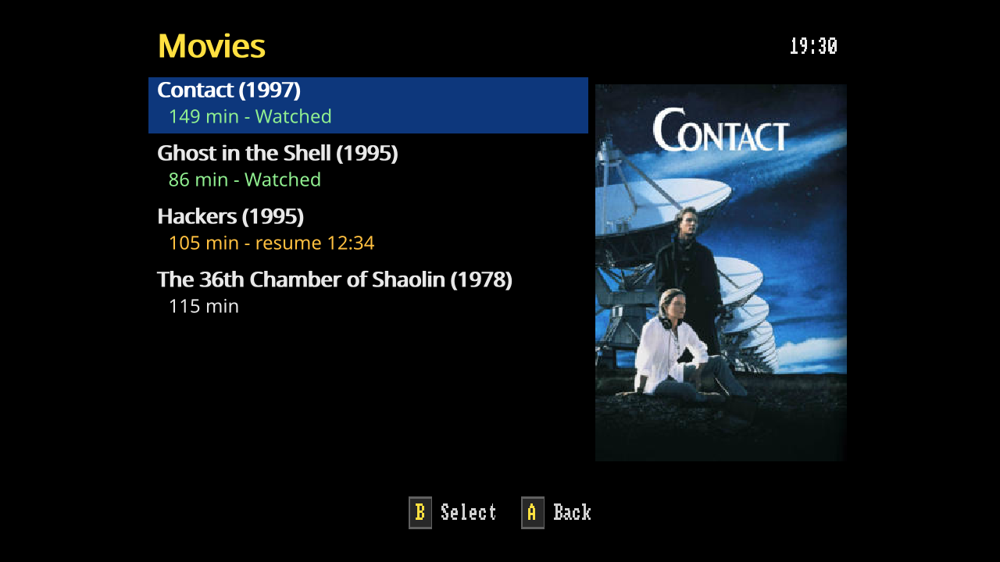 | 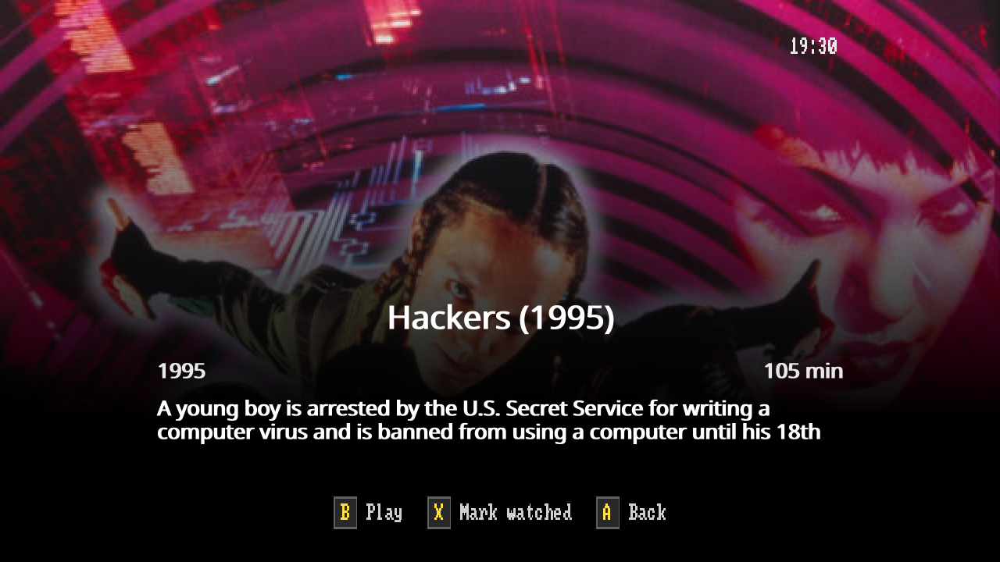 |

| Episode list | Next episode |
| --- | --- |
| 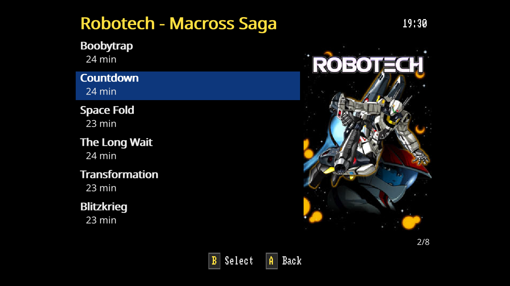 | 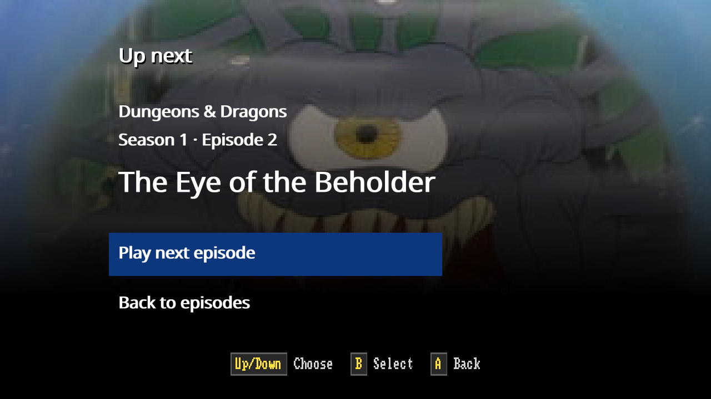 |

After an episode finishes, the next-episode screen waits for a choice. It uses the next episode’s preview image when available. See [next-episode behavior](GO_PLAYBACK.md#next-episode).

| Music playback | Music options |
| --- | --- |
| 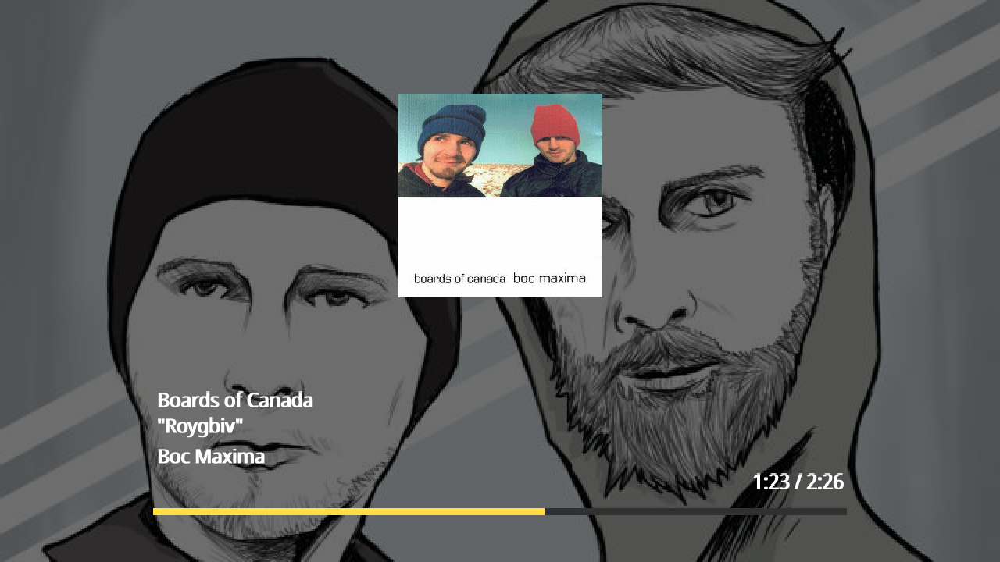 | 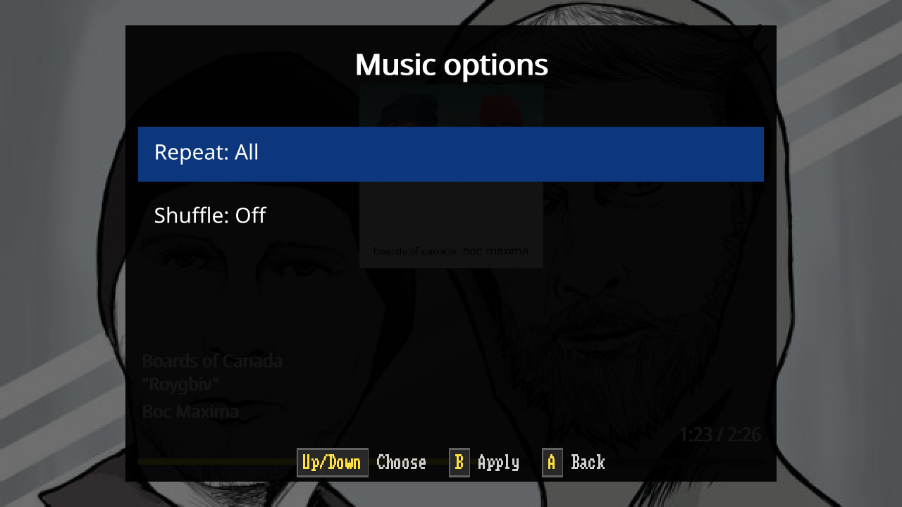 |

Select on a controller or Tab on a keyboard opens music options. X or O changes the background. See [music playback](GO_MUSIC.md).

## Connections and sign-in

Open About with Start on a controller or F1 on a keyboard, then press Down for Connections. **Use existing connection** appears only when a configured, remembered, or current connection is available.

| Connection choices | Jellyfin discovery |
| --- | --- |
| 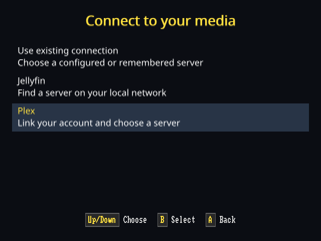 | 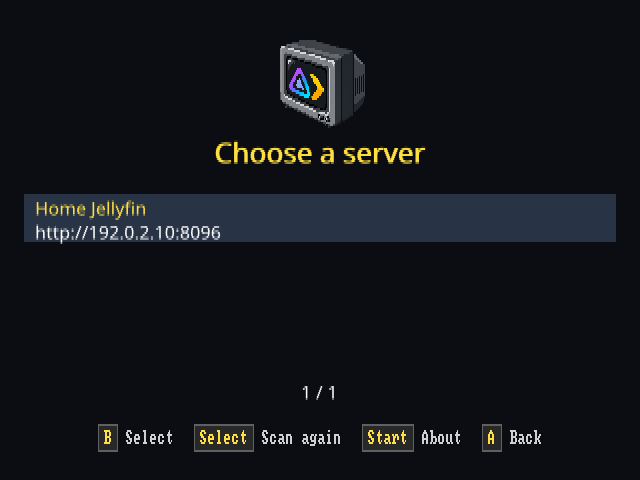 |

| Jellyfin Quick Connect | Plex account linking |
| --- | --- |
| 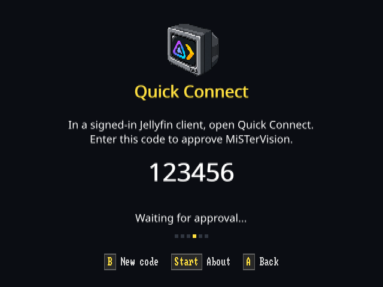 | 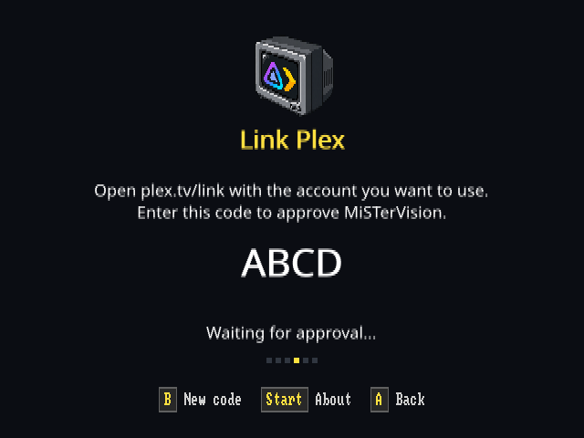 |

| Plex server selection | Setup help |
| --- | --- |
| 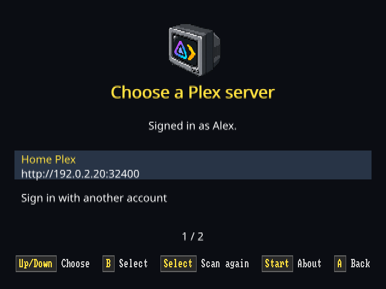 | 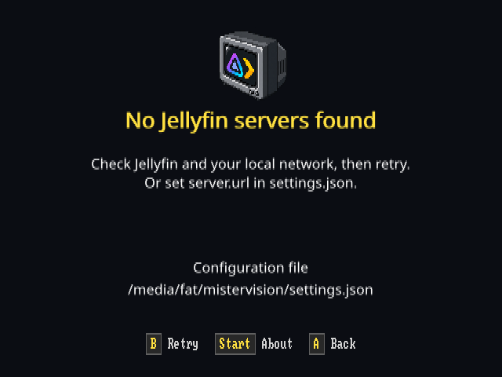 |

See [Jellyfin setup](GO_BROWSING.md#setup-and-sign-in), [Plex discovery](GO_PLEX.md#server-discovery), and [saved connections](GO_CONFIGURATION.md#multiple-connections).

## Saved Jellyfin users

Each saved user has approved Quick Connect independently. Select a user to switch libraries and viewing history. Add user starts another approval. Forget user removes the selected saved sign-in after confirmation.

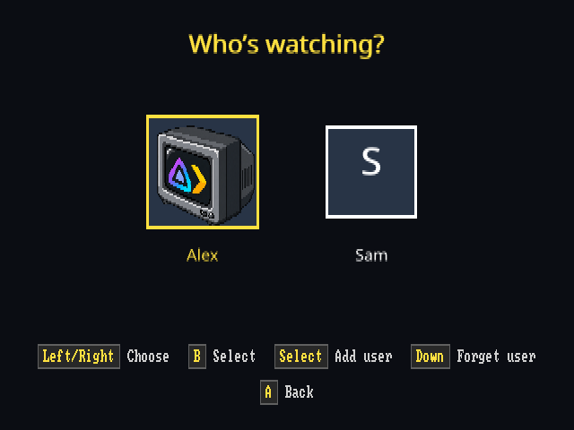

See [Jellyfin user switching](GO_BROWSING.md#jellyfin-users).

## Plex Home

The profile picker shows three cards at a time. Left/Right scrolls through additional viewers, and a counter shows the selection’s position. Protected viewers use the controller or keyboard keypad. The fourth digit submits the PIN. Digits and action labels are centered in their selection blocks.

| Viewing profiles | PIN entry |
| --- | --- |
| 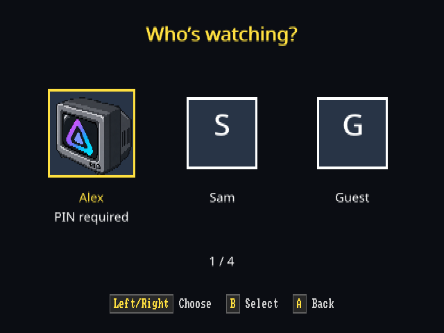 | 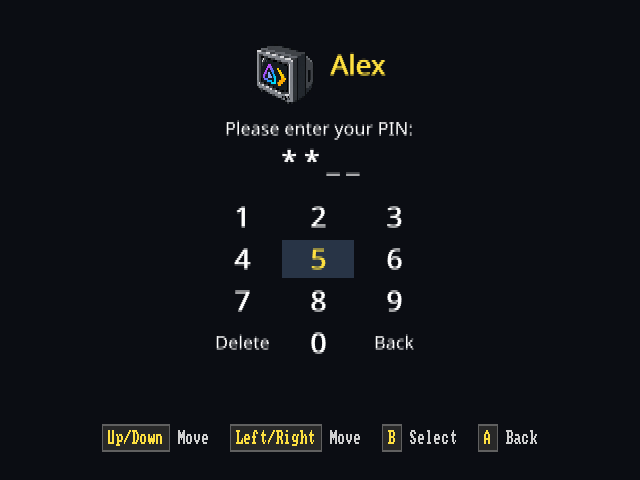 |

| About and account controls | Plex sign-out confirmation |
| --- | --- |
| 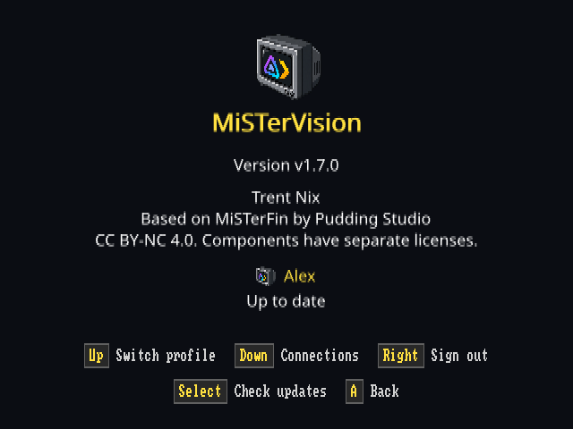 | 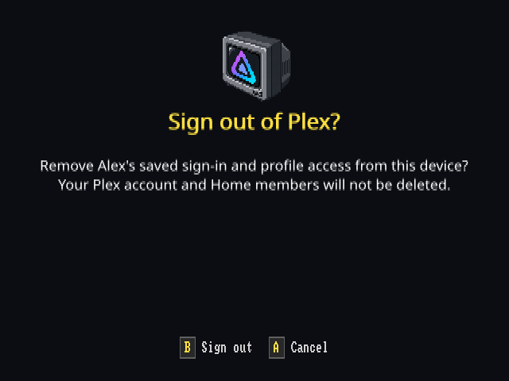 |

See [Plex Home behavior](GO_PLEX.md#plex-home-profiles) for remembered viewers, retry messages, cancellation, and permissions.

About keeps its logo, identity block, and navigation hints steady while checking for updates. The checking message stays visible for at least one second. Exit confirmation uses a full-width translucent stripe with equal top and bottom padding.

## Refreshing previews

From the repository root, regenerate the setup and About images with:

```sh
DOCS_PREVIEW_DIR="$PWD/docs/images/screenshots" \
  go test ./internal/rendering -run '^TestDocumentationPreviews$' -count=1
```

The [preview fixtures](../internal/rendering/docs_preview_test.go) use the current `RasterRenderer`. The command needs no server, account, credentials, or MiSTer. Ordinary tests skip the exporter. Review each image after changing layouts, and keep fixture text aligned with the connection flow.

For browsing and playback captures, use the [desktop harness](../tools/ghostty/README.md) with a media library, or render a staged scene with the production `RasterRenderer` and locally saved artwork. Let selection animations settle before exporting a frame. Use isolated development state when capturing them. Export complete frames, preserve the configured physical 4:3 or 16:9 proportions, and check for private account details before adding images to the repository. Do not include real sign-in codes or credential files.

Keep release announcement images and drafts in `announcements/<version>/` at the repository root. Git ignores that folder. Documentation screenshots belong in `docs/images/screenshots/`.
